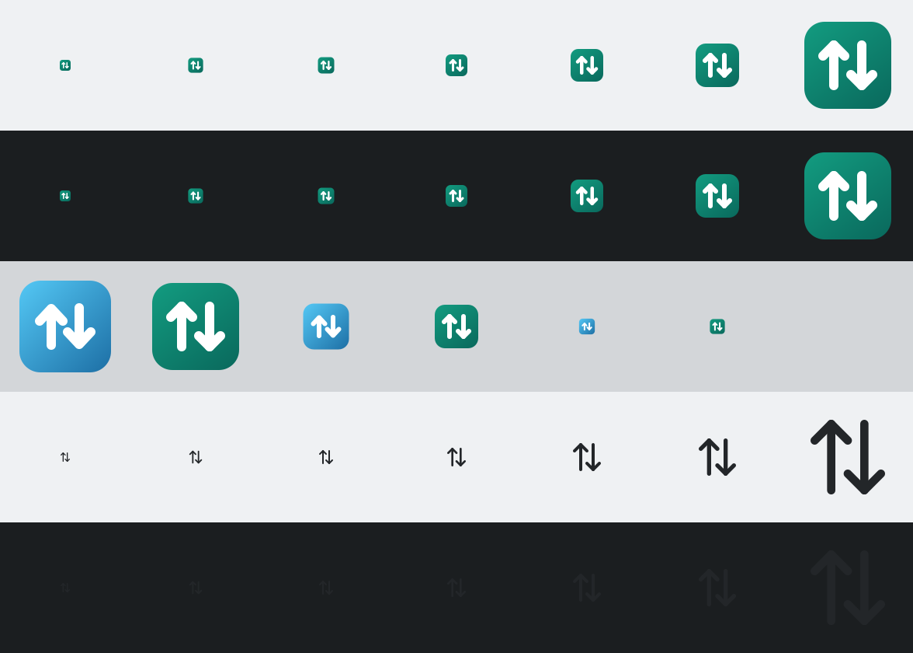

# LocalSend for KDE Plasma 6

Send and receive files on your local network from the Plasma panel. The widget ships its own backend, a
headless Python daemon that speaks the LocalSend v2 protocol, so it works on its own and alongside the
LocalSend apps already on your network.

- No app to keep open, no systemd unit, no D-Bus, no compiler at run time.
- Protocol `2.2`, interoperating with the official Android, iOS, Windows and macOS clients.
- Plasma 6 and `python3` 3.11 or newer. Nothing else.
- Everything the widget creates lives in your home directory, so removing the widget removes it all.



## Install

From a release archive:

```bash
kpackagetool6 --type Plasma/Applet --install io.github.localsend.plasmoid-0.2.0.plasmoid
kpackagetool6 --type Plasma/Applet --upgrade io.github.localsend.plasmoid-0.2.0.plasmoid   # later versions
```

From a clone:

```bash
./scripts/install.sh
```

Then right click the panel or desktop, **Add Widgets**, and pick **LocalSend**. To remove:

```bash
./scripts/uninstall.sh            # keep config and received files
./scripts/uninstall.sh --purge    # remove those too
```

## Use

| Task | How |
|---|---|
| See devices on the network | open the popup; the list refreshes on its own and the header shows the count |
| Send files | **Send…** on a device row, pick one or more files, confirm on the other device |
| Receive files | **Accept** on the notification or in the popup; files land in `~/Downloads/LocalSend` |
| Open the download folder | folder button in the popup header |
| Never prompt for your own phone | ★ on its row, then enable auto accept for trusted devices |
| Force a discovery round | refresh button in the popup header |
| Send while another transfer runs | it waits in the queue; cancel it from the active list before it starts |
| Retry a failed transfer | refresh button on the active row, only the files that failed are sent again |
| Review transfers | *History* tab, grouped by day; keeps 90 days and at most 200 transfers |
| Open a received file | click its row in the History tab |
| Open the containing folder | right click a row, **Open File Location**, the file is pre-selected in Dolphin |
| Turn the backend off | master switch in the popup footer; the daemon stops, the widget stays |
| Silence notifications | General settings of the widget, the only option there |

The tray icon shows a badge while transfers run and a spinner while the backend starts.

## Command line

The widget is a thin front end over a JSON control interface, and that interface is scriptable:

```bash
LS="sh ~/.local/share/plasma/plasmoids/io.github.localsend.plasmoid/contents/backend/manage.sh"
$LS ctl state                       # daemon, peers, sessions, prompts, history
$LS ctl peers                       # discovered devices
$LS ctl scan                        # announce now
$LS ctl send <fingerprint> FILE...  # start an outgoing transfer
$LS ctl respond <prompt-id> accept  # answer an incoming offer
$LS ctl cancel <session-id>         # abort a transfer
$LS ctl favorite <fingerprint> on   # trust a device
$LS ctl history | clear-history
$LS ctl shutdown
$LS ensure | stop | restart         # daemon lifecycle
$LS query-enabled                   # LOCALSEND_ENABLED or LOCALSEND_DISABLED
```

`$LS ctl state` is the one to remember: it answers everything the popup shows. The full verb list and
the JSON shapes are in [docs/dev.md](docs/dev.md#control-plane).

## Where things go

| Path | Contents |
|---|---|
| `~/Downloads/LocalSend` | received files, configurable in the widget settings |
| `~/.config/localsendd/` | `config.json`, `history.json`, TLS `cert.pem` and `key.pem` |
| `~/.local/share/localsend-applet/` | staged daemon, marker file for the master switch |
| `~/.cache/localsend-applet/` | `daemon.log` |
| `$XDG_RUNTIME_DIR/localsend-applet/` | control socket, lock and pid, gone after logout |

## Troubleshooting

| Symptom | Check |
|---|---|
| Widget greyed out, no devices | `$LS ctl state`; is the master switch on (`$LS query-enabled`)? |
| Backend will not start | read `~/.cache/localsend-applet/daemon.log`, then `$LS restart` |
| Duplicate daemons | `pgrep -af bin/localsendd`; the guards log why a second one exits |
| Phone cannot see the PC | same network? multicast allowed? firewall open on 53317 udp and tcp? |
| Transfer refused | the sender needs a PIN, or the prompt expired after 5 minutes |
| Start over | `./scripts/uninstall.sh --purge`, then install again |

Live log in a terminal: `journalctl --user -f | grep localsend`.

## What it does not do

- Text and clipboard messages from protocol v2.1. File transfers only.
- Dropping files onto the popup. Use the folder button or **Send…**.
- Two backends on one machine. They cannot discover each other, because the kernel load balances
  multicast between local sockets.

Planned: mDNS discovery for networks that drop multicast, accept and decline straight from the
notification, text and clipboard messages. See [CHANGELOG.md](CHANGELOG.md) for what shipped.

## Privacy

Discovery is multicast inside your local network and transfers go directly from device to device. No
account, no cloud relay, no telemetry. The TLS certificate is generated on your machine on first start.

## Development

```bash
make ci        # lint, 11 unit tests, package build
make test      # tests only
make package   # build/io.github.localsend.plasmoid-<version>.plasmoid
./scripts/restart-plasma.sh   # reload plasmashell after reinstalling the widget
```

Architecture, the control plane contract, protocol scope, packaging internals, release steps and the
mistakes already paid for: [docs/dev.md](docs/dev.md). Release history: [CHANGELOG.md](CHANGELOG.md).
KDE Store listing text: [docs/kde-store.md](docs/kde-store.md).

## License

MIT, see [LICENSE](LICENSE).
